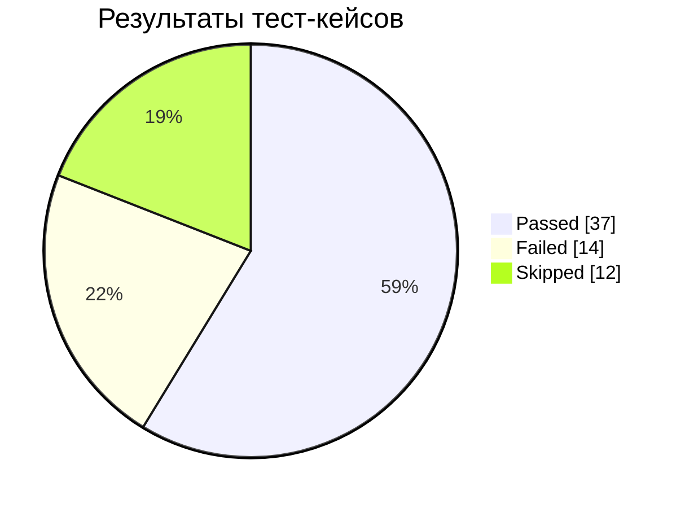
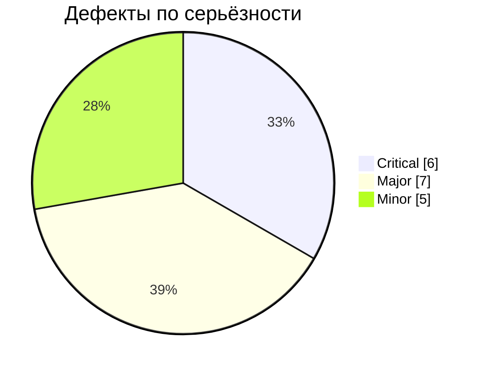
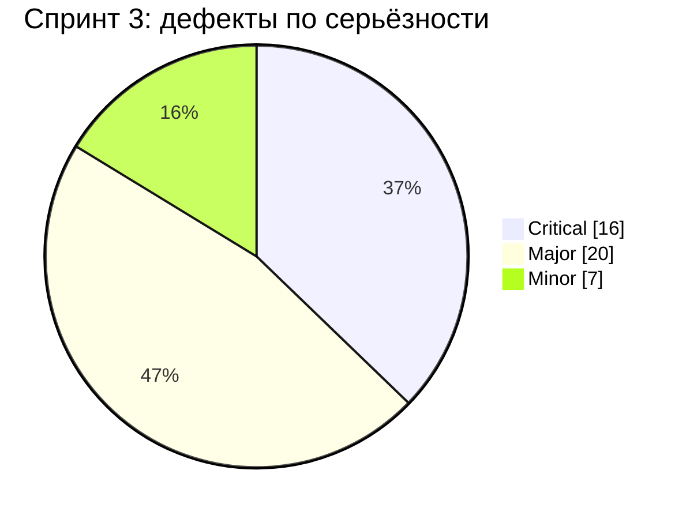
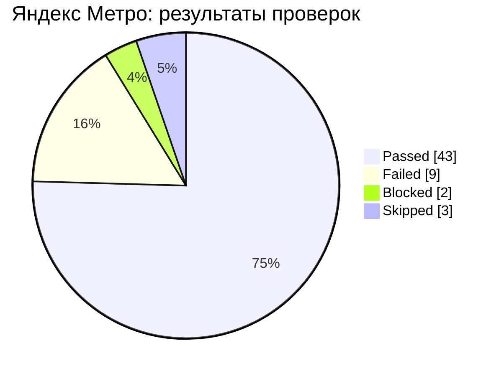

# qa-test-documentation

Портфолио тестовой документации по QA: тест-дизайн, тест-кейсы, баг-репорты, интерактивный чек-лист и автоматическая статистика.

🔗 **Онлайн-чек-лист тестировщика:** <https://ikqavscode-afk.github.io/qa-test-documentation/>

## Главная ценность

> **Сквозная прослеживаемость от неясного требования до решения о релизе.**
> Каждое «серое» место требований превращено в вопрос и допущение, затем в класс эквивалентности и проверку, а упавшая проверка — в воспроизводимый баг с метрикой и вердиктом No-Go. Ни одно утверждение в отчёте не висит в воздухе: его можно проследить до конкретного бага и шагов воспроизведения.

Что это показывает работодателю: умение мыслить как инженер по качеству, а не просто «прощёлкивать» интерфейс.

## Чек-листы проектов

У каждого проекта свой чек-лист: суть спринта, объект тестирования, направленность, область проверки и результаты. Интерактивная версия: **[Чек-листы проектов](https://ikqavscode-afk.github.io/qa-test-documentation/checklists.html)**.

| Проект | Объект тестирования | Направленность | Чек-лист |
|---|---|---|---|
| Спринт 1 · Mesto | веб-приложение: профиль и карточки | функциональное и регрессионное, валидация, ретест | [checklist.md](sprint-1-mesto/checklist.md) |
| Спринт 2 · Яндекс Маршруты | форма маршрута: время, адреса, расчёт | тест-дизайн, классы эквивалентности, границы | [checklist.md](sprint-2-YaM/checklist.md) |
| Спринт 3 · Каршеринг | форма бронирования | вёрстка, кроссбраузерность, логика окон | [checklist.md](spritn-3-CarSh/checklist.md) |
| Спринт 4 · Яндекс Метро | мобильное приложение Android | регрессия, мобильные факторы, решение о релизе | [checklist.md](spritn-4-YaMetro/checklist.md) |

## Проекты

| Проект | Описание |
|---|---|
| [sprint-1-mesto](sprint-1-mesto/) | Спринт 1: Mesto — регрессионные кейсы, баг-репорты и ретест веб-приложения |
| [sprint-2-YaM](sprint-2-YaM/) | Спринт 2: «Яндекс Маршруты» — валидация полей и расчёт стоимости/времени поездки |
| [spritn-3-CarSh](spritn-3-CarSh/) | Спринт 3: форма бронирования каршеринга — верстка и логика, 43 бага, серые зоны, отчёт о готовности |
| [spritn-4-YaMetro](spritn-4-YaMetro/) | Итоговый проект (спринт 4): «Яндекс Метро» для Android — регрессия после рефакторинга и решение о релизе |

## Статистика (автообновляется)

<!-- STATS:START (генерируется scripts/update_stats.py — не редактировать вручную) -->
     

| Область | Кейсов | ✅ | ❌ | ⏭ | Багов |
|---|---|---|---|---|---|
| Часы | 23 | 16 | 3 | 4 | 4 |
| Минуты | 23 | 17 | 2 | 4 | 3 |
| Откуда | 5 | 1 | 4 | 0 | 4 |
| Куда | 5 | 2 | 3 | 0 | 3 |
| Расчёт | 7 | 1 | 2 | 4 | 4 |

<!-- STATS:END -->

### Спринт 3 — каршеринг

<!-- STATS3:START (генерируется scripts/update_stats.py — не редактировать вручную) -->
       

<!-- STATS3:END -->

🔗 [Реестр багов](https://ikqavscode-afk.github.io/qa-test-documentation/sprint3/bugs.html) · [Матрица браузеров](https://ikqavscode-afk.github.io/qa-test-documentation/sprint3/matrix.html) · [Серые зоны](https://ikqavscode-afk.github.io/qa-test-documentation/sprint3/gray-zones.html) · [Тренажёр «Найди баг»](https://ikqavscode-afk.github.io/qa-test-documentation/sprint3/trainer.html)

### Яндекс Метро (Android) — итоговый проект

<!-- STATS4:START (генерируется scripts/update_stats.py — не редактировать вручную) -->
       

<!-- STATS4:END -->

🔗 [Реестр багов](https://ikqavscode-afk.github.io/qa-test-documentation/metro/bugs.html) · [Трассировка](https://ikqavscode-afk.github.io/qa-test-documentation/metro/matrix.html) · [Серые зоны](https://ikqavscode-afk.github.io/qa-test-documentation/metro/gray-zones.html) · [Симулятор решения о релизе](https://ikqavscode-afk.github.io/qa-test-documentation/metro/release.html)

## Что внутри

| Папка | Назначение |
|---|---|
| [sprint-1-mesto](sprint-1-mesto/) | спринт 1: кейсы, баги и ретест Mesto |
| [sprint-2-YaM](sprint-2-YaM/) | спринт 2: тест-дизайн, тест-кейсы, баг-репорты |
| [spritn-3-CarSh](spritn-3-CarSh/) | спринт 3: тест-анализ, серые зоны, чек-листы, баги, отчёты, ретест |
| [spritn-4-YaMetro](spritn-4-YaMetro/) | итоговый проект: мобильная регрессия, решение о релизе, трассировка |
| [data](data/) | исходные данные (JSON): результаты тестов и баги — из них строится статистика и Issues |
| [templates](templates/) | шаблоны тест-кейса, баг-репорта и чек-листа |
| [docs](docs/) | методика (конспекты) и сайт GitHub Pages с интерактивным чек-листом |
| [scripts](scripts/) | генерация статистики и создание Issues из багов |
| `.github` | формы Issues, метки, GitHub Actions |

## Баги как Issues

Дефекты (18 из спринта 2, 43 из спринта 3 и 13 из итогового проекта) оформляются как GitHub Issues с метками `severity:`, `priority:`, `area:`.
Создаются одной кнопкой: **Actions → Setup issues → Run workflow** (можно выбрать спринт или оба). Повторный запуск дубликатов не создаёт.

## Дорожная карта

- [x] Тест-дизайн: классы эквивалентности и граничные значения
- [x] Функциональное тестирование валидации полей и расчёта (63 кейса)
- [x] Оформление дефектов (18 баг-репортов)
- [x] Шаблоны, Issues, автостатистика, интерактивный чек-лист
- [x] Кроссбраузерная проверка верстки (Firefox и Яндекс Браузер, спринт 3)
- [ ] Кроссбраузерная проверка остальных браузеров (Chrome, Safari, Edge)
- [x] Мобильное тестирование: Android, ориентация, жесты, сеть (итоговый проект)
- [ ] Проверка на реальных устройствах и iOS
- [ ] Анализ запросов и логов в DevTools (вкладка Network, консоль)
- [ ] API-тестирование в Postman
- [ ] Автотесты валидации на Playwright + запуск в GitHub Actions
