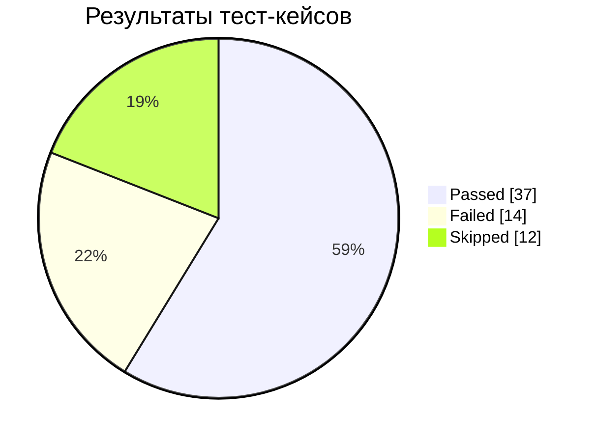
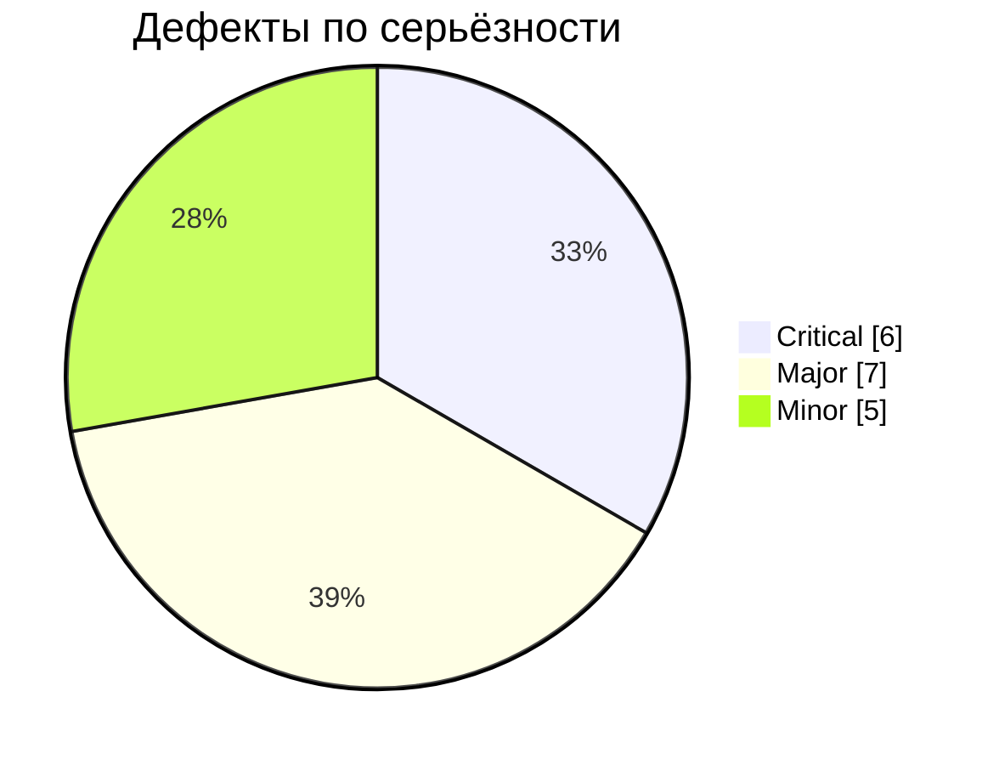
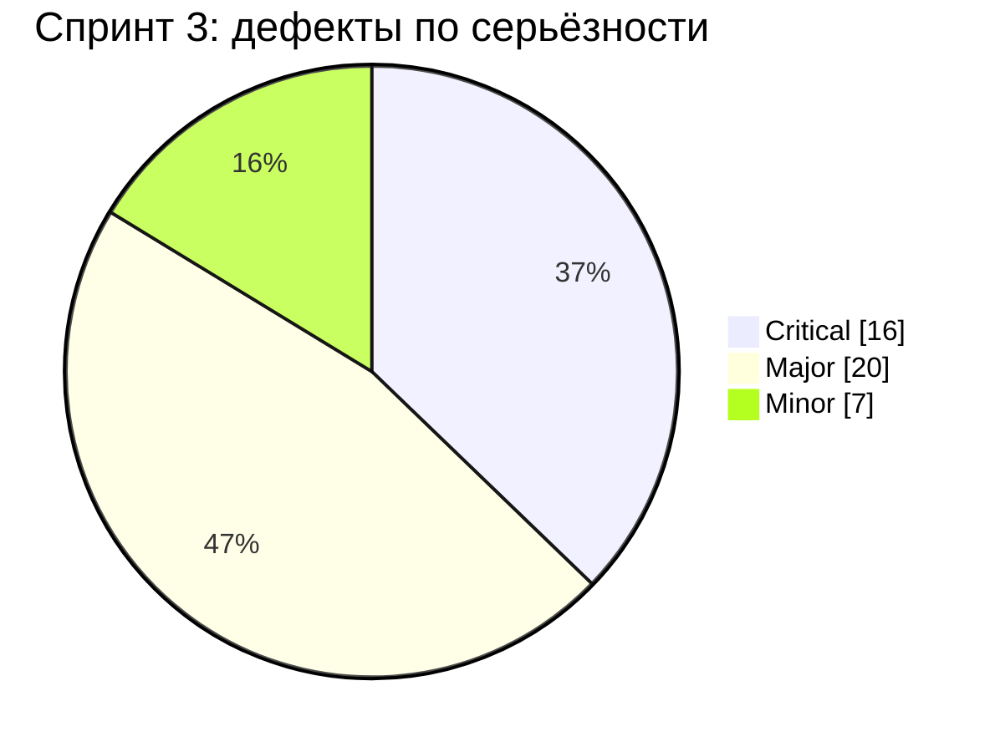
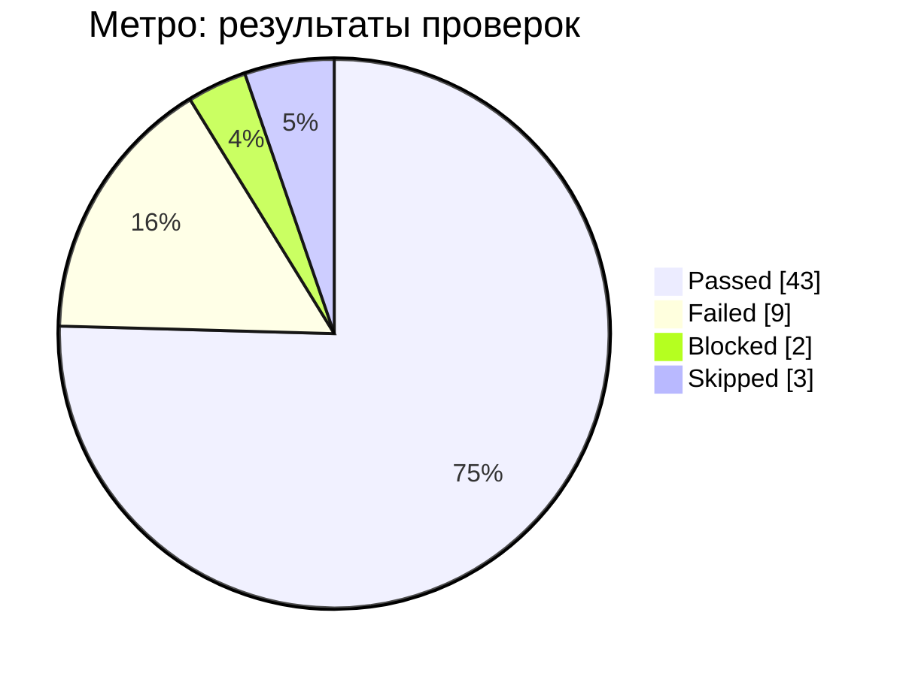

# qa-test-documentation

Комплект тестовой документации по QA: тест-дизайн, тест-кейсы, баг-репорты, отчёты, интерактивные чек-листы и автоматическая статистика.

🔗 **Онлайн-чек-лист тестировщика:** <https://ikqavscode-afk.github.io/qa-test-documentation/>

## О проекте

| | |
|---|---|
| **Цель** | Собрать в одном репозитории образцовый комплект тестовой документации по четырём объектам тестирования — от анализа требований до решения о релизе. |
| **Ценность** | Сквозная прослеживаемость: неясное место требований → вопрос и допущение → класс эквивалентности и проверка → воспроизводимый баг → метрика и решение о релизе. Любое утверждение в отчёте можно проследить до конкретного бага и шагов воспроизведения. |
| **Польза** | Готовые шаблоны, чек-листы и генераторы проверок можно использовать в других проектах; реестры багов, матрицы и отчёты служат примерами оформления; тренажёр помогает тренировать наблюдательность. |
| **Функции** | Хранение и версионирование тестовой документации; интерактивные чек-листы и генераторы проверок; реестры багов и Issues с метками; автоматическая статистика и диаграммы; симулятор решения о релизе; тренажёр «Найди баг». |

## Чек-листы проектов

У каждого проекта свой чек-лист: суть спринта, объект тестирования, направленность, область проверки и результаты. Интерактивная версия: **[Чек-листы проектов](https://ikqavscode-afk.github.io/qa-test-documentation/checklists.html)**.

| Проект | Объект тестирования | Направленность | Чек-лист |
|---|---|---|---|
| Спринт 1 · Places | веб-приложение: редактирование профиля | функциональное и регрессионное, валидация, баг-репорты | [checklist.md](sprint-1-places/checklist.md) |
| Спринт 2 · Маршруты | форма маршрута: время, адреса, расчёт | тест-дизайн, классы эквивалентности, границы | [checklist.md](sprint-2-Routes/checklist.md) |
| Спринт 3 · Каршеринг | форма бронирования | вёрстка, кроссбраузерность, логика окон | [checklist.md](spritn-3-CarSh/checklist.md) |
| Спринт 4 · Метро | мобильное приложение Android | регрессия, мобильные факторы, решение о релизе | [checklist.md](spritn-4-Metro/checklist.md) |
| Спринт 5 · Прилавок | бэкенд: REST и XML API | API-тестирование, Postman, HTTP-статусы, баг-репорты | [Sprint_5](https://github.com/ikqavscode-afk/Sprint_5) (отдельный репозиторий) |

## Тренажёры

Раздел для отработки навыков в браузере ([открыть](https://ikqavscode-afk.github.io/qa-test-documentation/lab/index.html)):

| Тренажёр | Что отрабатывает |
|---|---|
| [КЭ и граничные значения](https://ikqavscode-afk.github.io/qa-test-documentation/lab/ep.html) | классификация значений, подбор границ, серые зоны (12 полей из форм) |
| [Таблица принятия решений](https://ikqavscode-afk.github.io/qa-test-documentation/lab/decision.html) | построение всех комбинаций, проверка по эталону, сжатие, экспорт в Markdown; примеры: пицца, форма, кредит, вход и пароли KGramm, регистрация и пароль Помощника |
| [Найди баг и оформи отчёт](https://ikqavscode-afk.github.io/qa-test-documentation/lab/findbug.html) | поиск дефектов в форме заказа пиццы, проверка полноты баг-репорта |

## Проекты

| Проект | Описание |
|---|---|
| [sprint-1-places](sprint-1-places/) | Спринт 1: Places — регрессионные кейсы, баг-репорты и ретест веб-приложения |
| [sprint-2-Routes](sprint-2-Routes/) | Спринт 2: «Маршруты» — валидация полей и расчёт стоимости/времени поездки |
| [spritn-3-CarSh](spritn-3-CarSh/) | Спринт 3: форма бронирования каршеринга — верстка и логика, 43 бага, серые зоны, отчёт о готовности |
| [spritn-4-Metro](spritn-4-Metro/) | Итоговый проект (спринт 4): «Метро» для Android — регрессия после рефакторинга и решение о релизе |
| [Sprint_5](https://github.com/ikqavscode-afk/Sprint_5) | Спринт 5: «Прилавок» — тестирование API: 102 проверки, 45 дефектов, коллекция Postman, интерактивная консоль ([сайт](https://ikqavscode-afk.github.io/Sprint_5/)) |

## Статистика (автообновляется)

<!-- STATS:START (генерируется scripts/update_stats.py — не редактировать вручную) -->
     

| Область | Кейсов | ✅ | ❌ | ⏭ | Багов |
|---|---|---|---|---|---|
| Часы | 23 | 16 | 3 | 4 | 4 |
| Минуты | 23 | 17 | 2 | 4 | 3 |
| Откуда | 5 | 1 | 4 | 0 | 4 |
| Куда | 5 | 2 | 3 | 0 | 3 |
| Расчёт | 7 | 1 | 2 | 4 | 4 |

<!-- STATS:END -->

### Спринт 3 — каршеринг

<!-- STATS3:START (генерируется scripts/update_stats.py — не редактировать вручную) -->
       

<!-- STATS3:END -->

🔗 [Реестр багов](https://ikqavscode-afk.github.io/qa-test-documentation/sprint3/bugs.html) · [Матрица браузеров](https://ikqavscode-afk.github.io/qa-test-documentation/sprint3/matrix.html) · [Серые зоны](https://ikqavscode-afk.github.io/qa-test-documentation/sprint3/gray-zones.html) · [Тренажёр «Найди баг»](https://ikqavscode-afk.github.io/qa-test-documentation/sprint3/trainer.html)

### Метро (Android) — итоговый проект

<!-- STATS4:START (генерируется scripts/update_stats.py — не редактировать вручную) -->
       

<!-- STATS4:END -->

🔗 [Реестр багов](https://ikqavscode-afk.github.io/qa-test-documentation/metro/bugs.html) · [Трассировка](https://ikqavscode-afk.github.io/qa-test-documentation/metro/matrix.html) · [Серые зоны](https://ikqavscode-afk.github.io/qa-test-documentation/metro/gray-zones.html) · [Симулятор решения о релизе](https://ikqavscode-afk.github.io/qa-test-documentation/metro/release.html)

## Что внутри

| Папка | Назначение |
|---|---|
| [sprint-1-places](sprint-1-places/) | спринт 1: кейсы, баги и ретест Places |
| [sprint-2-Routes](sprint-2-Routes/) | спринт 2: тест-дизайн, тест-кейсы, баг-репорты |
| [spritn-3-CarSh](spritn-3-CarSh/) | спринт 3: тест-анализ, серые зоны, чек-листы, баги, отчёты, ретест |
| [spritn-4-Metro](spritn-4-Metro/) | итоговый проект: мобильная регрессия, решение о релизе, трассировка |
| [data](data/) | исходные данные (JSON): результаты тестов и баги — из них строится статистика и Issues |
| [templates](templates/) | шаблоны тест-кейса, баг-репорта и чек-листа |
| [docs](docs/) | методика (конспекты) и сайт GitHub Pages с интерактивным чек-листом |
| [scripts](scripts/) | генерация статистики и создание Issues из багов |
| `.github` | формы Issues, метки, GitHub Actions |

## Баги как Issues

Дефекты (18 из спринта 2, 43 из спринта 3 и 13 из итогового проекта) оформляются как GitHub Issues с метками `severity:`, `priority:`, `area:`.
Создаются одной кнопкой: **Actions → Setup issues → Run workflow** (можно выбрать спринт или оба). Повторный запуск дубликатов не создаёт.

## Дорожная карта

- [x] Тест-дизайн: классы эквивалентности и граничные значения
- [x] Функциональное тестирование валидации полей и расчёта (63 кейса)
- [x] Оформление дефектов (18 баг-репортов)
- [x] Шаблоны, Issues, автостатистика, интерактивный чек-лист
- [x] Кроссбраузерная проверка верстки (Firefox и Y-браузер, спринт 3)
- [ ] Кроссбраузерная проверка остальных браузеров (Chrome, Safari, Edge)
- [x] Мобильное тестирование: Android, ориентация, жесты, сеть (итоговый проект)
- [ ] Проверка на реальных устройствах и iOS
- [ ] Анализ запросов и логов в DevTools (вкладка Network, консоль)
- [ ] API-тестирование в Postman
- [ ] Автотесты валидации на Playwright + запуск в GitHub Actions
