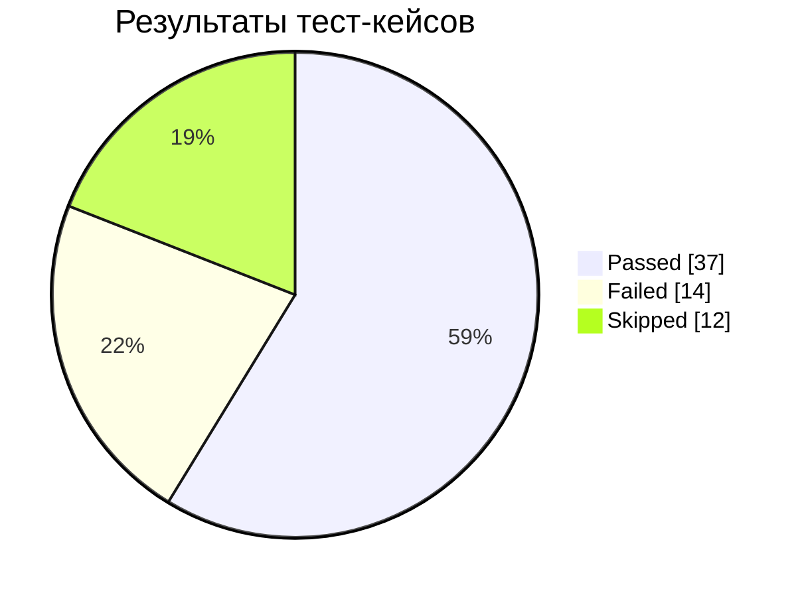
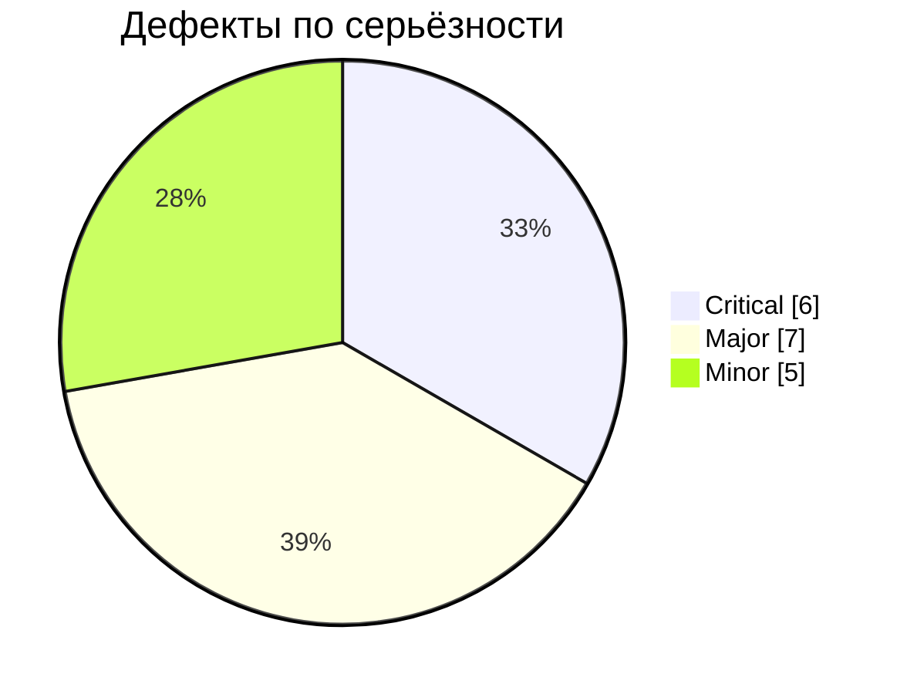

# qa-test-documentation

Портфолио тестовой документации по QA: тест-дизайн, тест-кейсы, баг-репорты, интерактивный чек-лист и автоматическая статистика.

🔗 **Онлайн-чек-лист тестировщика:** <https://ikqavscode-afk.github.io/qa-test-documentation/>

## Проекты

| Проект | Описание |
|---|---|
| [sprint-2-YaM](sprint-2-YaM/) | Спринт 2: «Яндекс Маршруты» — валидация полей и расчёт стоимости/времени поездки |

## Статистика (автообновляется)

<!-- STATS:START (генерируется scripts/update_stats.py — не редактировать вручную) -->
     

| Область | Кейсов | ✅ | ❌ | ⏭ | Багов |
|---|---|---|---|---|---|
| Часы | 23 | 16 | 3 | 4 | 4 |
| Минуты | 23 | 17 | 2 | 4 | 3 |
| Откуда | 5 | 1 | 4 | 0 | 4 |
| Куда | 5 | 2 | 3 | 0 | 3 |
| Расчёт | 7 | 1 | 2 | 4 | 4 |

<!-- STATS:END -->

## Что внутри

| Папка | Назначение |
|---|---|
| [sprint-2-YaM](sprint-2-YaM/) | тест-дизайн, тест-кейсы, баг-репорты со скриншотами |
| [data](data/) | исходные данные (JSON): результаты тестов и баги — из них строится статистика и Issues |
| [templates](templates/) | шаблоны тест-кейса, баг-репорта и чек-листа |
| [docs](docs/) | методика (конспекты) и сайт GitHub Pages с интерактивным чек-листом |
| [scripts](scripts/) | генерация статистики и создание Issues из багов |
| `.github` | формы Issues, метки, GitHub Actions |

## Баги как Issues

18 дефектов оформляются как GitHub Issues с метками `severity:`, `priority:`, `area:`.
Создаются одной кнопкой: **Actions → Setup issues → Run workflow**. Повторный запуск дубликатов не создаёт.

## Дорожная карта

- [x] Тест-дизайн: классы эквивалентности и граничные значения
- [x] Функциональное тестирование валидации полей и расчёта (63 кейса)
- [x] Оформление дефектов (18 баг-репортов)
- [x] Шаблоны, Issues, автостатистика, интерактивный чек-лист
- [ ] Кроссбраузерная проверка (Chrome, Firefox, Safari, Edge)
- [ ] Проверка на мобильных устройствах
- [ ] Анализ запросов и логов в DevTools (вкладка Network, консоль)
- [ ] API-тестирование в Postman
- [ ] Автотесты валидации на Playwright + запуск в GitHub Actions
