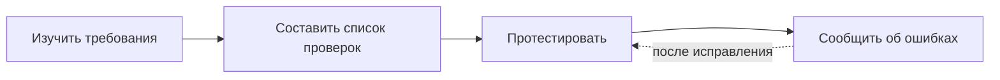

# Цикл тестирования

## Уточняющие вопросы перед стартом
| Тема | Что выяснить |
|---|---|
| Контекст | Какая функциональность сделана и что именно проверять |
| Ресурсы | Где взять сборку с изменениями, кто автор требований |
| Срок | К какому времени нужен результат |
| Исполнение | Куда выносить баги и кейсы, кому сообщить о завершении |

## Как это применено в проекте
- Из требований выделены поля и правила валидации → [декомпозиция и классы эквивалентности](../../sprint-2-Routes/test-design/equivalence-classes-and-boundaries.md).
- На основе классов составлены [тест-кейсы](../../sprint-2-Routes/test-cases/test-cases.md).
- По упавшим кейсам оформлены [баг-репорты](../../sprint-2-Routes/bug-reports/bug-reports.md).

## Чек-лист и тест-кейс
- **Чек-лист** — список пунктов «элемент + ожидаемое поведение», быстрый и лёгкий.
- **Тест-кейс** — подробный сценарий: предусловия, шаги, ожидаемый результат, статус.
- Статус **Skipped** — кейс сознательно не выполнялся (например, нет времени или он дублирует другой).
