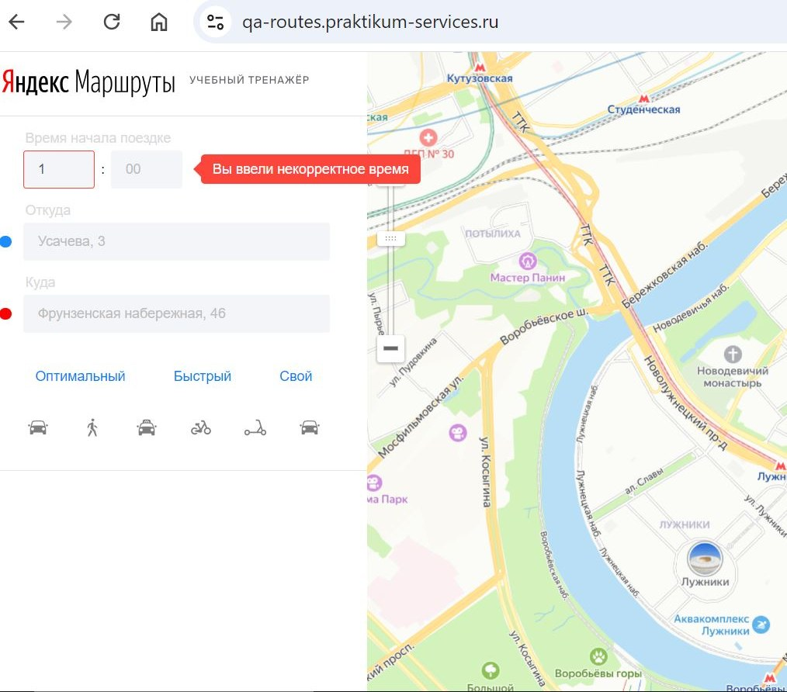
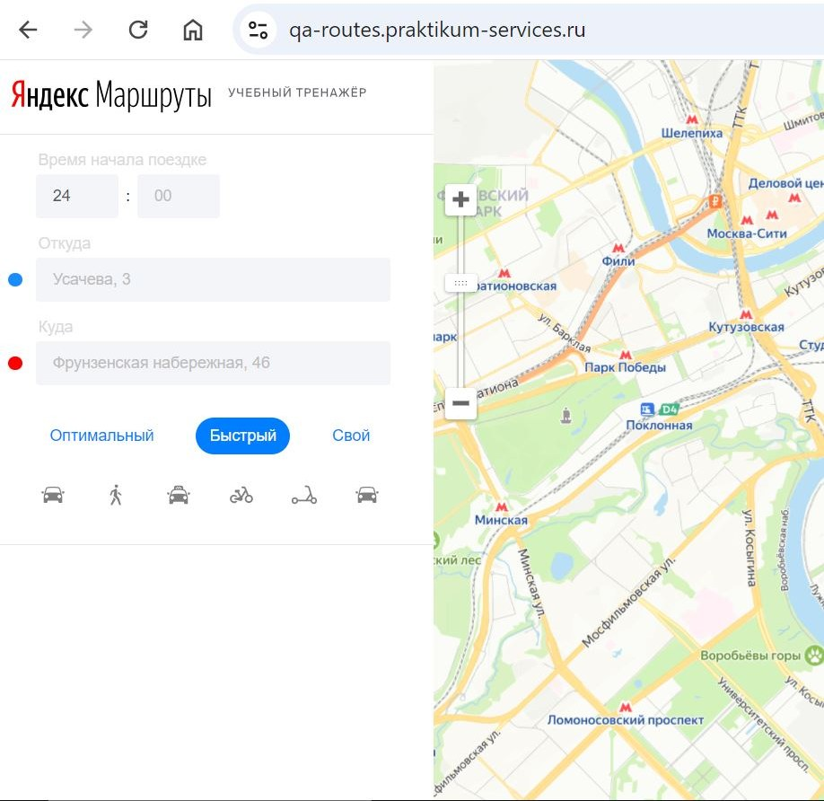
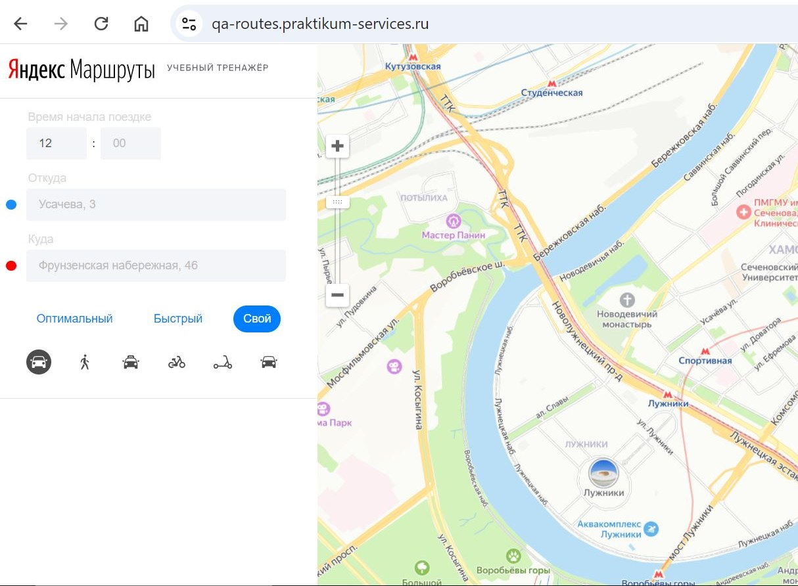
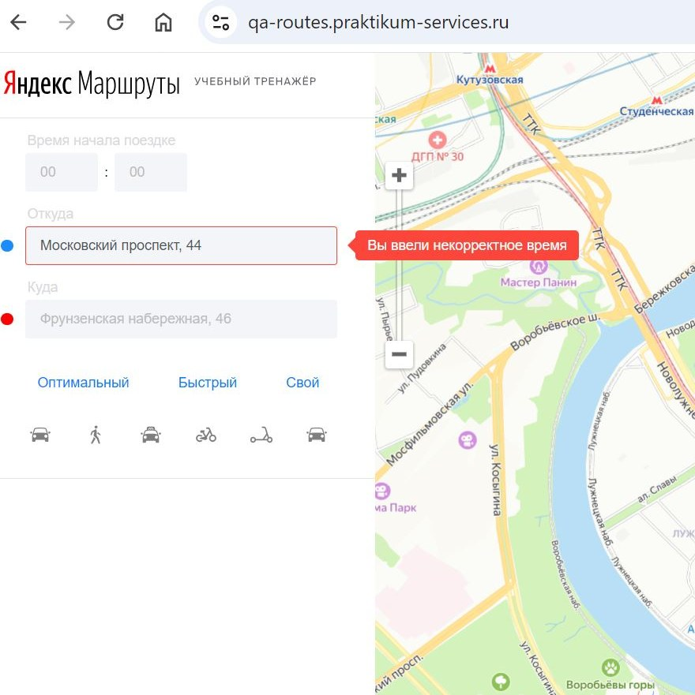
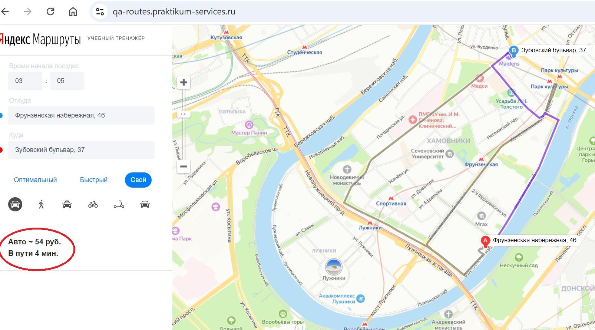

# Баг-репорты (демо-версия)

Всего найдено **18** дефектов; ниже — 7 типичных. Приоритеты: Критический / Стандартный / Желательный.

| ID | Название | Приоритет |
|---|---|---|
| ЯМ-Т2-Б1 | Поле "Часы" Не проставляется 0 перед однозначными числами | Стандартный |
| ЯМ-Т2-Б1а | Поле "Часы" Появляется ошибка при вводе однозначного числа "1" | Критический |
| ЯМ-Т16-Б2 | Поле "Часы"Не появляется ошибка введении навалидного числа "24" | Стандартный |
| ЯМ-Т23-Б3 | Поле "Часы"Не появляется ошибка при оставлении пустым | Стандартный |
| ЯМ-Т25-Б4 | Поле "Минуты" Не проставляется 0 перед однозначными числами при вводе однозначного числа "1" | Стандартный |
| ЯМ-Т25-Б4а | Поле "Минуты" Появляется ошибка при вводе однозначного числа "1" | Критический |
| ЯМ-Т45-Б5 | Поле "Минуты" Не появляется ошибка при пустом значении | Стандартный |
| ЯМ-Т48-Б6 | Поле "Откуда" не происходит автоматического удаление пробела до введенного значения " Усачева, 3" | Желательный |
| ЯМ-Т49-Б7 | Поле "Откуда" не происходит автоматического удаление пробела после введенного значения "Комсомольский проспект 18 " | Желательный |
| ЯМ-Т50-Б8 | Поле "Откуда" текст сообщения об Ошибке не соответствует требованиям | Желательный |
| ЯМ-Т51-Б9 | Поле "Откуда" Не появляется ошибка при пустом значении. | Стандартный |
| ЯМ-Т53-Б10 | Поле "Куда" не происходит автоматического удаление пробела до введенного значения " Усачева,3" | Желательный |
| ЯМ-Т54-Б11 | Поле "Куда" не происходит автоматического удаление пробела после введенного значения "Комсомольский проспект, 18 " | Желательный |
| ЯМ-Т56-Б12 | Поле "Куда" Не появляется ошибка при пустом значении. | Стандартный |
| ЯМ-Т57-Б13 | Не верные данные при расчете время поездки: на собственном автомобиле при начале движения с 00:01 до 08:00 (03:05) между разными адресами | Критический |
| ЯМ-Т57-Б13а | Не верные данные при расчете стоимость поездки: на собственном автомобиле при начале движения с 00:01 до 08:00 (03:05) между разными адресами | Критический |
| ЯМ-Т62-Б18 | Не верные данные при расчете время поездки: на собственном автомобиле при начале движения с 08:01 до 12:00 (09:15) между разными адресами в обратном направлении | Критический |
| ЯМ-Т62-Б18а | Не верные данные при расчете стоимость поездки: на собственном автомобиле при начале движения с 08:01 до 12:00 (09:15) между разными адресами в обратном направлении | Критический |

---

## ЯМ-Т2-Б1: Поле "Часы" Не проставляется 0 перед однозначными числами

**Приоритет:** Стандартный · **Статус:** Открыт

**Предусловия:** Открыто приложение «Маршруты»

**Шаги:**

1. Убедиться что поле "Время начало поездке" "Часы" в фокусе, поле пустое (кликнуть курсором в поле "Часы");

2. Ввести в поле "Часы" "1";

3. Сместить фокус с поля "Часы" (в другой элемент поля или в любое место страницы)

**Ожидаемый результат:** Перед однозначным числом автоматические выставляется Ноль.

**Фактический результат:** Перед однозначным числом автоматические не выставляется Ноль.

---

## ЯМ-Т2-Б1а: Поле "Часы" Появляется ошибка при вводе однозначного числа "1"

**Приоритет:** Критический · **Статус:** Открыт

**Предусловия:** Открыто приложение «Маршруты»

**Шаги:**

1. Убедиться что поле "Время начало поездке" "Часы" в фокусе, поле пустое (кликнуть курсором в поле "Часы");

2. Ввести в поле "Часы" "1";

3. Сместить фокус с поля "Часы" (в другой элемент поля или в любое место страницы)

**Ожидаемый результат:** Поле прошло валидацию. Рамка не подсвечивается красным. НЕТ Сообщения об ошибке "Вы ввели некорректное время".

**Фактический результат:** Поле НЕ прошло валидацию. Рамка ПОДСВЕЧИВАЕТСЯ красным. Сообщение об ошибке: Вы ввели некорректное время

---

## ЯМ-Т16-Б2: Поле "Часы"Не появляется ошибка введении навалидного числа "24"

**Приоритет:** Стандартный · **Статус:** Открыт

**Предусловия:** Открыто приложение «Маршруты»

**Шаги:**

1. Убедиться что поле "Часы" в фокусе, поле пустое

2. Ввести в поле "Часы" "24";

3. Сместить фокус с поля "Часы"

**Ожидаемый результат:** Поле НЕ прошло валидацию. Рамка ПОДСВЕЧИВАЕТСЯ красным. Сообщение об ошибке: Вы ввели некорректное время.

**Фактический результат:** Поле прошло валидацию. Рамка не подсвечивается красным. Сообщение об ошибке НЕТ.

---

## ЯМ-Т45-Б5: Поле "Минуты" Не появляется ошибка при пустом значении

**Приоритет:** Стандартный · **Статус:** Открыт

**Предусловия:** Открыто приложение «Маршруты»

**Шаги:**

1. Убедиться что поле "Минуты" в фокусе

2. Оставить поле "Минуты" пустым;

3. Убрать Фокус с поля "Минуты"

**Ожидаемый результат:** Поле НЕ прошло валидацию. Рамка ПОДСВЕЧИВАЕТСЯ красным. Сообщение об ошибке: Вы ввели некорректное время.

**Фактический результат:** Рамка НЕ ПОДСВЕЧИВАЕТСЯ красным. НЕТ Сообщение об ошибке: Вы ввели некорректное время.

---

## ЯМ-Т48-Б6: Поле "Откуда" не происходит автоматического удаление пробела до введенного значения " Усачева, 3"

**Приоритет:** Желательный · **Статус:** Открыт

**Предусловия:** Открыто приложение «Маршруты»

**Шаги:**

1. Убедиться что поле "Откуда" в фокусе, поле пустое

2. Ввести в поле "Откуда" с пробелом до значения " Усачева, 3"

3. Сместить фокус с поля "Откуда"

**Ожидаемый результат:** Пробелы автоматически удаляются.

**Фактический результат:** Пробелы не удаляются автоматически.

---

## ЯМ-Т50-Б8: Поле "Откуда" текст сообщения об Ошибке не соответствует требованиям

**Приоритет:** Желательный · **Статус:** Открыт

**Предусловия:** Открыто приложение «Маршруты»

**Шаги:**

1. Убедиться что поле "Откуда" в фокусе, поле пустое

2. Ввести в поле "Откуда" значения "Московский проспект, 44"

3. Сместить фокус с поля "Откуда"

**Ожидаемый результат:** Поле не прошло валидацию. Рамка подсвечивается красным. Сообщение об ошибке "Вы ввели некорректный адрес".

**Фактический результат:** Поле не прошло валидацию. Рамка подсвечивается красным. Сообщение об ошибке "Вы ввели некорректное время". (ссылка на скриншот в комментарии

---

## ЯМ-Т57-Б13: Не верные данные при расчете время поездки: на собственном автомобиле при начале движения с 00:01 до 08:00 (03:05) между разными адресами

**Приоритет:** Критический · **Статус:** Открыт

**Предусловия:** 1. Открыто приложение «Маршруты» 2. Убедиться что все поля пустые, не выбран режим маршрута, не выбран тип траснпорта

**Шаги:**

1. Ввести в форму "Время начала поезкди":

- в поле "Часы" "03"; в поле "Минуты" "05";

2. Ввести в поле "Откуда" "Фрунзенская набережная, 46";

3. Ввести в поле "Куда" "Зубовский бульвар, 37";

4. Выбрать режим маршрута "Свой";

5. Выбрать вид транспорта "собственный автомобиль" (левая крайняя иконка)

**Ожидаемый результат:** 1. На карте построится маршрут; 2. Ниже поля выбора видов транспорта отобразится время и стоимость поездки: . В пути 7 мин.

**Фактический результат:** 1. Маршрут построен; 2. Ниже поля выбора видов транспорта отобразится время и стоимость поездки: В пути 4 мин.

---
