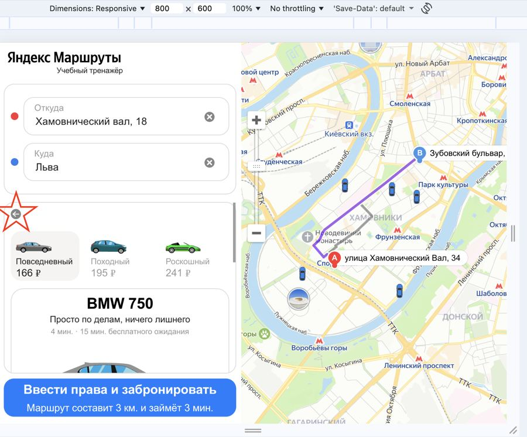
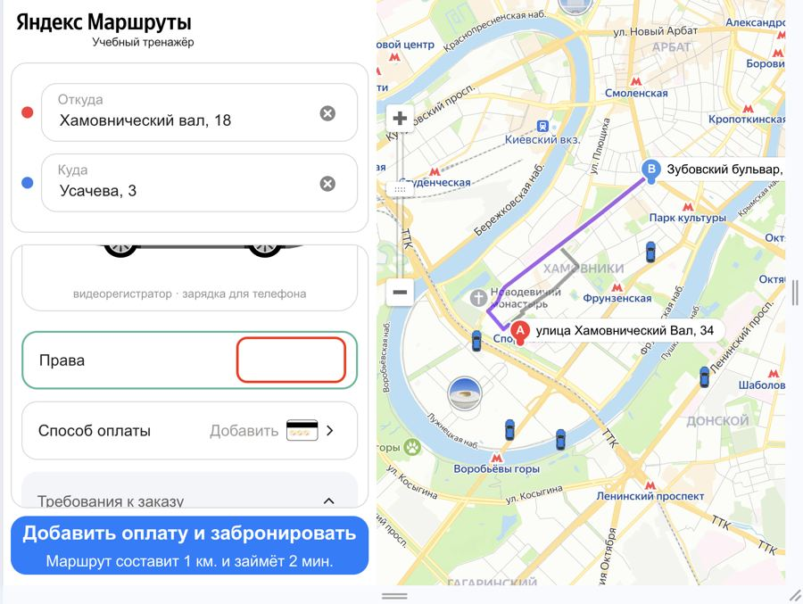
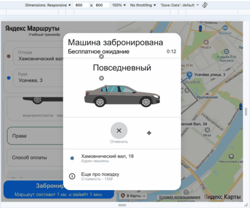
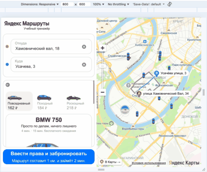
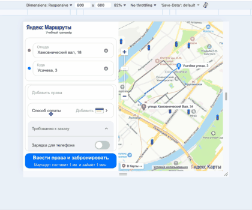

# Баг-репорты (демо-версия)

Всего найдено **43** дефектов. Здесь — 10 показательных. Все 43 с фильтрами: https://ikqavscode-afk.github.io/qa-test-documentation/sprint3/bugs.html

| ID | Название | Серьёзность | Область |
|---|---|---|---|
| Б1 | Кнопка Назад в форме бронирования в виде белой стрелки влево | minor | Верстка формы |
| Б2 | В блоке информации выбранного тарифа, в подзаголовке отсутствует фигурка бегущего человечка | minor | Верстка формы |
| Б3 | В блоке информации выбранного тарифа, в подзаголовке, Время в пути: Текст "4 мин". Отображается с точкой после слова "мин." | minor | Верстка формы |
| Б4 | В блоке информации выбранного тарифа, в подзаголовке, Время бесплатного ожидания: Текст: "15 мин бесплатного ожидания". Отображается с точкой после слова "15 мин." | minor | Верстка формы |
| Б5 | Плейсхолдер Текст "Добавить права", "Шеврон-вправо" отсутсвует | minor | Верстка формы |
| Б6 | В поле "Добавить права" 30 секундный таймер не появляется | critical | Права |
| Б7 | В поле "Добавить права" у правого края не появляется зеленая галочка. | critical | Права |
| Б8 | Окно "Добавить права" Возможно редактировать введенные ранее данные водительского удостоверения | critical | Права |
| Б9 | Текст "Способ оплаты" цвет текста черный. | major | Верстка формы |
| Б10 | Панель "Требование к заказу" открыта. "Шеврон-вверх" выровненный по правому краю, цвет серый | major | Верстка формы |
| Б11 | Панель "Требование к заказу" открыта при возврате в тариф "Повседневный" | major | Верстка формы |
| Б12 | Текст на кнопке "Забронировать" "Ввести права и забронировать Маршрут составит .. км и займет .. мин" | major | Верстка формы |
| Б13 | Текст на кнопке "Забронировать" "Ввести права и забронировать Маршрут составит .. км и займет .. мин" | major | Верстка формы |
| Б14 | Все обязательные поля заполнены, адреса удалены. Форма бронирования закрывается, переход на главную страницу с полями "Откуда" и "Куда" | critical | Логика кнопки |
| Б15 | Окно Машина забронирована расплагается в центре экрана, закрывая наполовину форму Бронирования | major | Окно «Машина забронирована» |
| Б16 | Между текстом "Машина" и "Забронирована" на переднем плане иконка удаления данных из поля "Откуда" из формы бронироания | major | Окно «Машина забронирована» |
| Б17 | Таймер "Бесплатного ожидания" при выборе тарифа "Повседневный" 10 минут. | major | Окно «Машина забронирована» |
| Б18 | Блок с информацией об автомоблиле на переднем плане иконка удаления данных поля "Куда" | minor | Окно «Машина забронирована» |
| Б19 | Нет разделения двух нижних блоков между собой, усеченной горизонтальной линией | minor | Окно «Машина забронирована» |
| Б20 | Отменить заказ невозможно. Кнопка "Отменить заказ" некликабельна | critical | Окно «Машина забронирована» |
| Б21 | Время останавливается на 0:01 сек. Таймер не начинает отсчитывать время пользования каршерингом. | critical | Окно «Машина забронирована» |
| Б22 | На карте изображены не все свободные автомобили всех тарифов | critical | Карта и иконки |
| Б23 | Иконки машин направлены в одну сторону (вверх карты) | major | Карта и иконки |
| Б24 | Все иконки машин одинакового размера. Плашка над иконкой ближайшей машины отстутствует | critical | Карта и иконки |
| Б25 | Невозможно выбрать машину на карте, любого тарифа, кликнув на иконку. | critical | Карта и иконки |
| Б26 | Невозможно добавить неограниченное количество карт (20) | critical | Способ оплаты |
| Б27 | Невозможно добавить дубликат карты (две карты с одинаковыми данными) | critical | Способ оплаты |
| Б28 | При добавлении карты, в окне "Способ оплаты", вместо текста "Добавить карту" в поле "Добавить карту", текст "Карта" | critical | Способ оплаты |
| Б29 | В окне "Добавление карты". При вводе данных в поле Номер карты цвет текста серый | major | Добавление карты |
| Б30 | В окне "Добавление карты". При вводе данных в поле Код цвет текста серый | major | Добавление карты |
| Б31 | В окне "Добавление карты". При вводе данных в поле Номер карты в формате "123400004321" и снятия фокуса пробелы не ставятся автоматически | major | Добавление карты |
| Б32 | В окне "Добавление карты" поле "Код" возможно ввести "00" | critical | Добавление карты |
| Б33 | Клик по кнопке бронирования не открывает окно "Добавление прав" при НЕ заполнении поля "Добавить права" | critical | Логика кнопки |
| Б34 | Клик по кнопке бронирования не открывает окно "Добавление карты " при НЕ заполнении поля "Способ оплаты " | critical | Логика кнопки |
| Б35 | При введении в поле "Номер карты" "123400004321"; в поле "Код" 00 Кнопка "Привязать" НЕАКТИВНА | critical | Добавление карты |
| Б36 | В поле "Номер карты" ВОЗМОЖЕН ввод больше 12 символов"1234000043210" | major | Добавление карты |
| Б37 | В поле "Код" ВОЗМОЖЕН ввод больше 3 символов"100" | major | Добавление карты |
| Б38 | В поле "Код" ВОЗМОЖЕН ввод Букв "аб" | major | Добавление карты |
| Б39 | В поле "Номер карты" ВОЗМОЖЕН ввод Букв "123400004321а" | major | Добавление карты |
| Б40 | В поле "Номер карты" ВОЗМОЖЕН ввод Спецсимволов "123400004321№" | major | Добавление карты |
| Б41 | В поле "Код" ВОЗМОЖЕН ввод Спецсимволов "%№" | major | Добавление карты |
| Б42 | В поле "Номер карты" ВОЗМОЖЕН РУЧНОЙ ВВОД ПРОБЕЛОВ "1234 0000 4321" | major | Добавление карты |
| Б43 | В поле "Код" ВОЗМОЖЕН РУЧНОЙ ВВОД ПРОБЕЛОВ " 1" | major | Добавление карты |

---

## Б1: Кнопка Назад в форме бронирования в виде белой стрелки влево

**Серьёзность:** minor · **Область:** Верстка формы

**Окружение:** macOS, Y-браузер, 800×600; Windows 10, Firefox, 1920×1080

**Шаги:**

1. Ввести в поле Откуда "Хамовнический вал, 18"

2. Ввести в поле Куда ""Усачева, 3"

3. Выбрать режим "Свой"

4. Выбрать вид транспорта "Каршеринг"

5. Нажать на кнопку "Забронировать"

**Ожидаемый результат:** Вид кнопки "Шеврон-влево" цвет белый, внутри фигуры в форме круга, цвет серый

**Фактический результат:** Вид кнопки "Стрелка-влево" цвет белый, внутри фигуры в форме круга, цвет серый.

---

## Б6: В поле "Добавить права" 30 секундный таймер не появляется

**Серьёзность:** critical · **Область:** Права

**Окружение:** macOS, Y-браузер, 800×600; Windows 10, Firefox, 1920×1080

**Шаги:**

1. Кликнуть по полю "Добавить права"

2. Заполнить все обязательные поля в форме добавления прав, данные

3. Кликнуть на кнопку "Добавить"

4. Кликнуть на кнопку "Принято"

**Ожидаемый результат:** После отправки данных по водительским правам в поле "Добавить права" появляется 30 секундный таймер. цвет текста черный

**Фактический результат:** В поле "Добавить права" 30 секундный таймер не появляется

---

## Б8: Окно "Добавить права" Возможно редактировать введенные ранее данные водительского удостоверения

**Серьёзность:** critical · **Область:** Права

**Окружение:** macOS, Y-браузер, 800×600; Windows 10, Firefox, 1920×1080

**Шаги:**

1. Кликнуть по полю "Добавить права"

2. Заполнить все обязательные поля в форме добавления прав, данные

3. Кликнуть на кнопку "Добавить"

4. Кликнуть на кнопку "Принято"

5. Кликнуть по полю "Права"

**Ожидаемый результат:** После прохождения верификации редактировать данные водительского удостоверения невозможно

**Фактический результат:** Возможно редактировать введенные ранее данные водительского удостоверения

---

## Б14: Все обязательные поля заполнены, адреса удалены. Форма бронирования закрывается, переход на главную страницу с полями "Откуда" и "Куда"

**Серьёзность:** critical · **Область:** Логика кнопки

**Окружение:** macOS, Y-браузер, 800×600; Windows 10, Firefox, 1920×1080

**Шаги:**

1. Выбрать тариф "Повседневный" 2. Добавить банковскую карту 3. Добавить права 4. Удалить данные из поля "Откуда" 5. Удалить данные из поля "Куда"

**Ожидаемый результат:** Текст на кнопке "Забронировать" "Забронировать"

**Фактический результат:** Форма бронирования закрывается, значения удаляются, происходит переход на страницу ввода адресов

---

## Б17: Таймер "Бесплатного ожидания" при выборе тарифа "Повседневный" 10 минут.

**Серьёзность:** major · **Область:** Окно «Машина забронирована»

**Окружение:** macOS, Y-браузер, 800×600; Windows 10, Firefox, 1920×1080

**Шаги:**

1. Выбрать тариф "Повседневный" 2. Добавить банковскую карту 3. Добавить права 4. Нажать на кнопку "Забронировать"

**Ожидаемый результат:** По правому краю в шапке окна, на уровне текста Бесплатное ожидание, таймер, с обратным отчетом согласно выбранному тарифу (Повседневный -15 мин), цвет текста таймера черный

**Фактический результат:** Таймер, при выборе тарифа Повседневный -10 мин, цвет текста таймера черный

---

## Б20: Отменить заказ невозможно. Кнопка "Отменить заказ" некликабельна

**Серьёзность:** critical · **Область:** Окно «Машина забронирована»

**Окружение:** macOS, Y-браузер, 800×600; Windows 10, Firefox, 1920×1080

**Шаги:**

1. Выбрать тариф "Повседневный" 2. Добавить банковскую карту 3. Добавить права 4. Нажать на кнопку "Забронировать" 5. Нажать кнопку "Отменить заказ"

**Ожидаемый результат:** Пока таймер работает, можно бесплатно отменить заказ.

**Фактический результат:** Отменить заказ невозможно. Кнопка "Отменить заказ" некликабельна

---

## Б25: Невозможно выбрать машину на карте, любого тарифа, кликнув на иконку.

**Серьёзность:** critical · **Область:** Карта и иконки

**Окружение:** macOS, Y-браузер, 800×600; Windows 10, Firefox, 1920×1080

**Шаги:**

1. Ввести в поле Откуда "Хамовнический вал, 18" 2. Ввести в поле Куда ""Усачева, 3" 3. Выбрать режим "Свой" 4. Выбрать вид транспорта "Каршеринг" 5. Нажать на кнопку "Забронировать" 6. Кликнуть на любую иконку машины на карте

**Ожидаемый результат:** Выбрать можно любую машину на карте, любого тарифа, кликнув на иконку

**Фактический результат:** Иконки на карте не кликабельные

---

## Б27: Невозможно добавить дубликат карты (две карты с одинаковыми данными)

**Серьёзность:** critical · **Область:** Способ оплаты

**Окружение:** macOS, Y-браузер, 800×600; Windows 10, Firefox, 1920×1080

**Шаги:**

1. Кликнуть по полю "Способ оплаты"

2. Кликнуть по полю "Добавления карты" в форме "Способ оплаты"

3.Ввести в поле "Номер карты" "12340004321", в поле "Код" "12"

4. Кликнуть на кнопку "Привязать"

5. Повторить действия пунктов 2-4 еще 1 раз (С теми же данными карты)

**Ожидаемый результат:** Невозможно добавить дубликат карты (две карты с одинаковыми данными)

**Фактический результат:** В форме Добавление карты кнопка "Привязать" Активна, обе карты сохраняются в форме "Способ оплаты" с возможностью выбора любой.

---

## Б32: В окне "Добавление карты" поле "Код" возможно ввести "00"

**Серьёзность:** critical · **Область:** Добавление карты

**Окружение:** macOS, Y-браузер, 800×600; Windows 10, Firefox, 1920×1080

**Шаги:**

1. Кликнуть в поле "Способ оплаты" 2. Кликнуть в поле "Добавить карту" 3. В поле "Код" вветси "00"

**Ожидаемый результат:** В поле "Код" невозможно ввести "00"

**Фактический результат:** В поле "Код" возможно ввести "00"

---

## Б34: Клик по кнопке бронирования не открывает окно "Добавление карты " при НЕ заполнении поля "Способ оплаты "

**Серьёзность:** critical · **Область:** Логика кнопки

**Окружение:** macOS, Y-браузер, 800×600; Windows 10, Firefox, 1920×1080

**Шаги:**

1. Кликнуть в поле "Добавить права" 2. Ввести данные в форме "Добавления прав" 3. Нажать на кнопку "Добавить 4. Нажать на кнопку "Бронирования"

**Ожидаемый результат:** Текст на кнопке: "Добавить оплату и забронировать Маршрут составит .. км и займет .. мин" При нажатии на кнопку Бронирования открывается окно «Добавление карты»

**Фактический результат:** При нажатии на кнопку открывается окно «Машина забронированна»

---
