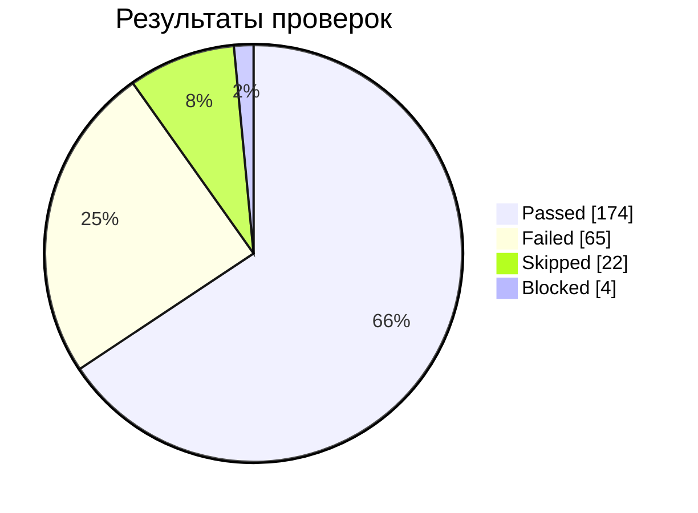
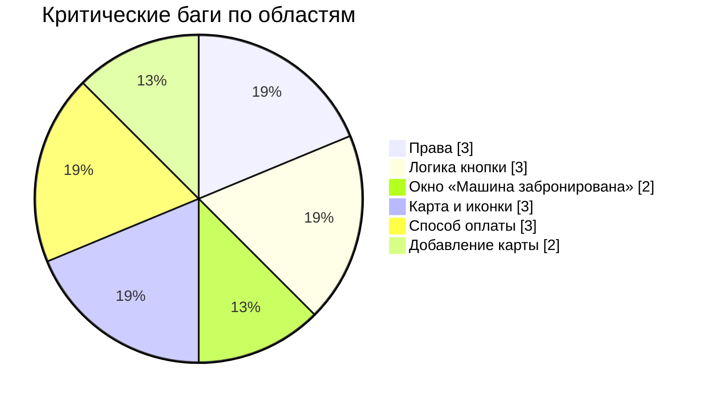

# Отчёт о готовности к релизу

**Объект:** форма бронирования каршеринга, тариф «Повседневный». **Вердикт: ❌ No-Go.**

## Метрики
| Метрика | Значение |
|---|---|
| Проверок / результатов | 163 / 265 |
| Passed | 174 (65.7% от всех результатов) |
| Failed | 65 |
| Skipped / Blocked | 22 / 4 |
| Pass rate среди выполненных | 72.8% |
| Баги Critical / Major / Minor | 16 / 20 / 7 |

## Критерии выхода (демо-критерии)
| Критерий | Порог | Факт | Результат |
|---|---|---|---|
| Открытых Blocker/Critical багов | 0 | 16 | ❌ |
| Pass rate среди выполненных | ≥ 90% | 72.8% | ❌ |
| Заблокированных проверок | 0 | 4 | ❌ |
| Покрытие проверок выполнено | ≥ 95% | 90% | ❌ |

## Ключевые риски
- Нельзя выбрать машину на карте и отменить заказ (Б20, Б25) — основной сценарий не завершается.
- Логика кнопки бронирования открывает не те окна (Б33, Б34) — пользователь не может добавить права и оплату.
- Окно «Добавление карты» не валидирует ввод (Б32, Б35–Б43) — риск некорректных платёжных данных.
- Таймер бесплатного ожидания не совпадает с тарифом и останавливается (Б17, Б21).

## Что не проверено
Окна подтверждения отмены (16 результатов пропущено), другие тарифы, расчёт расстояния и времени на кнопке.

## Рекомендации
1. Исправить все Critical и повторить проверки (см. [ретест](../regression/retest-checklist.md)).
2. Закрыть [серые зоны](../test-analysis/gray-zones.md) высокого риска до исправлений.
3. Расширить проверки на другие тарифы и окна отмены.

> Цифры пересчитаны из таблиц результатов. Исходный отчёт содержал расхождения в числе проверок и процентах, поэтому в документации использованы пересчитанные значения.
