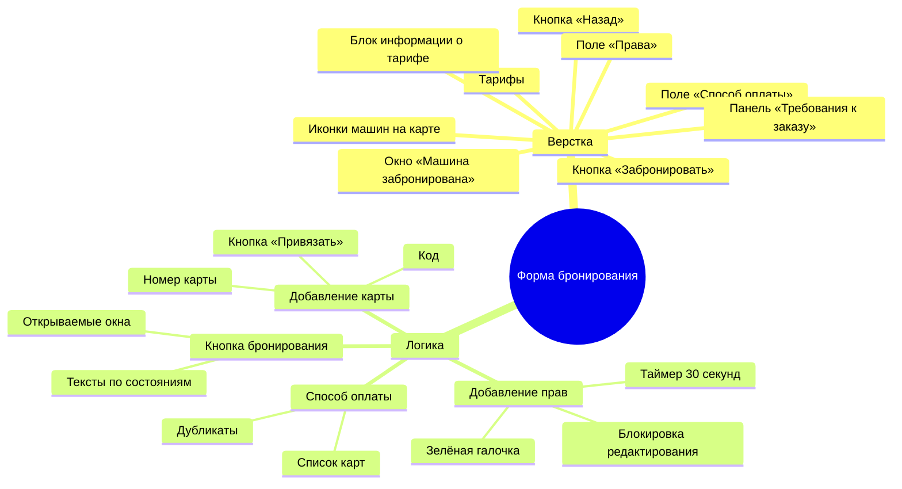

# Декомпозиция формы бронирования

## Как раскладывается элемент
Для каждого элемента верстки проверяются характеристики: положение, размеры, отступы, цвет, шрифт, форма, состояние. Генератор таких проверок — в [интерактивном чек-листе](https://ikqavscode-afk.github.io/qa-test-documentation/).

## Таблица решений: кнопка «Забронировать»
| Права добавлены | Оплата добавлена | Адреса заполнены | Текст кнопки | Действие по клику |
|---|---|---|---|---|
| да | да | да | Забронировать | окно «Машина забронирована» |
| нет | да | да | Добавить права и забронировать | окно «Добавление прав» |
| да | нет | да | Добавить оплату и забронировать | окно «Добавление карты» |
| любые | любые | нет | Добавить права и забронировать (допущение) | окно «Добавление прав» |
