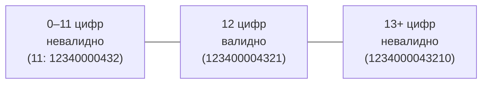
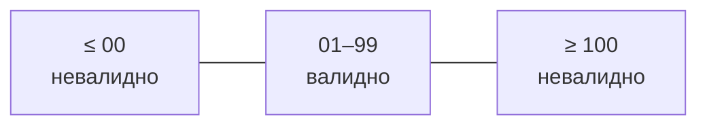

# Классы эквивалентности и граничные значения

## Поле «Номер карты» (12 цифр)

| Класс | Данные внутри | Границы |
|---|---|---|
| Меньше 12 (невалидно) | 11 цифр: `12340000432` | 0, 1, 11 |
| Ровно 12 (валидно) | `123400004321` | 11, 12, 13 |
| Больше 12 (невалидно) | 15 цифр: `123400004321000` | 12, 13 |
| Буквы | `12340000432а` | — |
| Спецсимволы | `12340000432№` | — |
| Пробелы | `1234 0000 4321` | — |
| Пустое поле | — | — |

## Поле «Код» (допущение: 2 цифры, 01–99)

| Класс | Данные внутри | Границы |
|---|---|---|
| Меньше 01 | `00`, `-1` | −1, 00, 01 |
| 01–99 (валидно) | `35` | 00, 01, 02, 98, 99, 100 |
| Больше 99 | `546` | 99, 100, 101 |
| Буквы / спецсимволы | `0б`, `0№` | — |
| Пробел | ` 1` | — |
| Пустое поле | — | — |

> Границы и допустимость значений «00» и 3-значного кода — предмет [серой зоны GZ1](gray-zones.md).

## Попарные комбинации (фрагмент)
| № | Номер карты | Код | Ожидание |
|---|---|---|---|
| 1 | 123400004321 | 01 | «Привязать» активна |
| 2 | 123400004321 | 99 | «Привязать» активна |
| 3 | 123400004321 | 00 | «Привязать» неактивна |
| 4 | 12340000432 | 35 | «Привязать» неактивна |
| 5 | пусто | 35 | «Привязать» неактивна |
