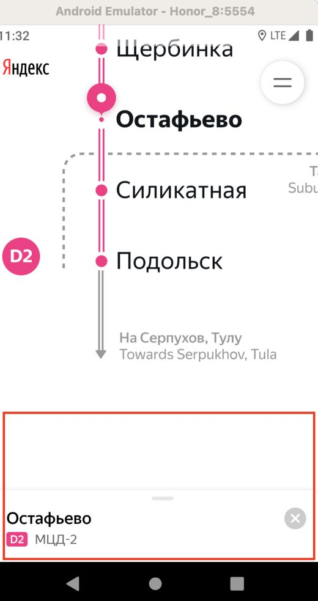
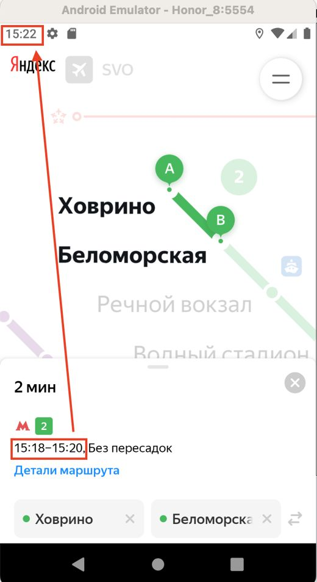
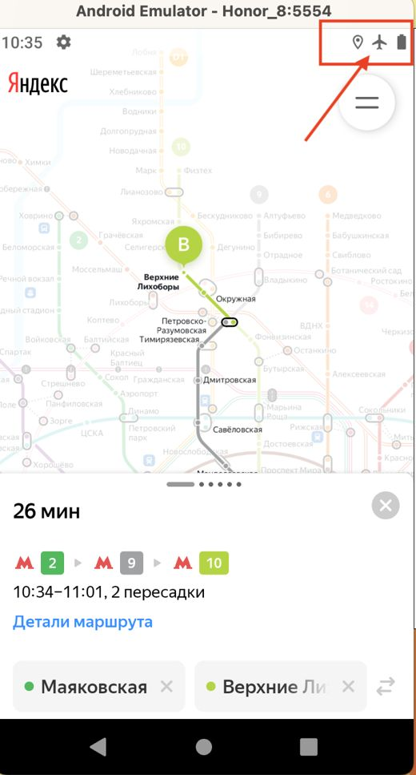
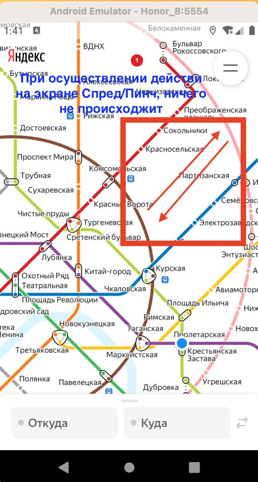
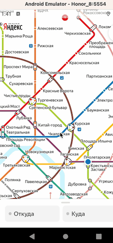
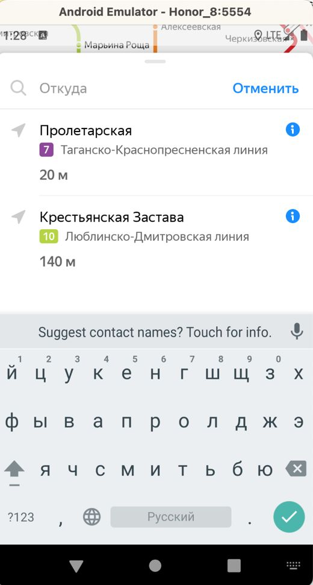
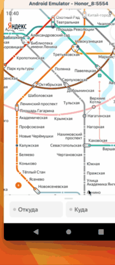

# Баг-репорты (демо-версия)

Всего найдено **13** дефектов. Здесь — 8 показательных. Все — с фильтрами: https://ikqavscode-afk.github.io/qa-test-documentation/metro/bugs.html

| ID | Название | Серьёзность | Область |
|---|---|---|---|
| Б1 | Лонг-тап по станции не открывает карточку с кнопками «Отсюда» и «Сюда» | major | Жесты и карта |
| Б2 | Станция, которая была первой в списке, не становится последней | major | История |
| Б3 | Временной интервал маршрута, в карточке маршрута, не обновляется (например, 10:45–11:00 - при 11:01 интервал сдвигается) | critical | Время и тема |
| Б4 | При смене ориентации Карточка маршрута не сохраняет положение: свёрнутая - свёрнутая | major | Смена ориентации |
| Б5 | При смене ориентации Карточка маршрута не сохраняет положение: открытая - открытая | major | Смена ориентации |
| Б6 | Нет уведомления об ошибке при отсутствии интернет-соеденения | critical | Сеть |
| Б7 | Пинч/спред — масштабирование карты не происходит | critical | Жесты и карта |
| Б8 | Не происходит автоматической смена темы (18:00 тёмная, 6:00 светлая) по московскому времени | major | Время и тема |
| Б9 | История не удаляется полностью | major | История |
| Б10 | Чистая установка, новая (не обновление). В истории завросов станций появляется Станция "Крестянская застава" | major | История |
| Б11 | При смене ориентации Карточка маршрута не сохраняет положение: свернута - свернута | major | Смена ориентации |
| Б12 | Лонг-тап по станции меняет положение положение схемы | major | Жесты и карта |
| Б13 | При смене с портретной на ландшафтную детали маршрута не отображаются | major | Смена ориентации |

---

## Б1: Лонг-тап по станции не открывает карточку с кнопками «Отсюда» и «Сюда»

**Серьёзность:** major · **Область:** Жесты и карта

**Окружение:** «Метро» для Android v3.6; Android 9.0, 1080×1920 (эмулятор и смартфон)

**Предусловия:** 1. Открыть приложение «Метро»

**Шаги:**

1. Применить Лонг-тап по станции местро "Остафьево"

**Ожидаемый результат:** Лонг-тап по станции открывает карточку с кнопками «Отсюда» и «Сюда», схема не меняет положение

**Фактический результат:** Карточка не октрывается полностью.

---

## Б3: Временной интервал маршрута, в карточке маршрута, не обновляется (например, 10:45–11:00 - при 11:01 интервал сдвигается)

**Серьёзность:** critical · **Область:** Время и тема

**Окружение:** «Метро» для Android v3.6; Android 9.0, 1080×1920 (эмулятор и смартфон)

**Предусловия:** 1. Открыть приложение «Метро»

**Шаги:**

1. В поле "Откуда" выбрать станцию "Теплый стан"

2. В поле "Куда" выбрать станцию "Коньково"

3. Дождатся пока текущее время не превысит на 1 минуту время прибытия поезда, в карточке маршрута

**Ожидаемый результат:** Временной интервал маршрута, в карточке маршрута, обновился, согласно текущему времени на устройстве

**Фактический результат:** Временной интервал маршрута, в карточке маршрута, не обновился, согласно текущему времени на устройстве

---

## Б4: При смене ориентации Карточка маршрута не сохраняет положение: свёрнутая - свёрнутая

**Серьёзность:** major · **Область:** Смена ориентации

**Окружение:** «Метро» для Android v3.6; Android 9.0, 1080×1920 (эмулятор и смартфон)

**Предусловия:** 1. Открыть приложение «Метро» 2. В поле "Откуда" выбрать станцию "Теплый стан" 3. В поле "Куда" выбрать станцию "Коньково"

**Шаги:**

1. Свайпом вниз свернуть карточку маршрута

2. Сменить ориентацию экрана с портретной на ландшафтную

**Ожидаемый результат:** При смене ориентации Карточка маршрута сохраняет положение: свёрнутая - свёрнутая

**Фактический результат:** При смене ориентации Карточка маршрута положение среднее

---

## Б6: Нет уведомления об ошибке при отсутствии интернет-соеденения

**Серьёзность:** critical · **Область:** Сеть

**Окружение:** «Метро» для Android v3.6; Android 9.0, 1080×1920 (эмулятор и смартфон)

**Предусловия:** 1. Отключить и нтернет-соеденение на устройстве 2. Открыть приложение «Метро»

**Шаги:**

1. Убедиться в наличии уведомления об ошибке

2. В поле "Откуда" выбрать станцию "Теплый стан"

3. В поле "Куда" выбрать станцию "Коньково"

4. Убедиться в наличии уведомленияё об ошибке

**Ожидаемый результат:** При отсутствии интернет-соединения появляется уведомление об ошибке

**Фактический результат:** Уведомления об ошибке НЕТ

---

## Б7: Пинч/спред — масштабирование карты не происходит

**Серьёзность:** critical · **Область:** Жесты и карта

**Окружение:** «Метро» для Android v3.6; Android 9.0, 1080×1920 (эмулятор и смартфон)

**Предусловия:** 1. Открыть приложение «Метро»

**Шаги:**

1. Выполнить действия на карте спрэд/пинч для увеличения и уменеьшения масштабируемости карты

**Ожидаемый результат:** Пинч/спред — масштабирование карты происходит

**Фактический результат:** Пинч/спред — масштабирование карты не происходит

---

## Б8: Не происходит автоматической смена темы (18:00 тёмная, 6:00 светлая) по московскому времени

**Серьёзность:** major · **Область:** Время и тема

**Окружение:** «Метро» для Android v3.6; Android 9.0, 1080×1920 (эмулятор и смартфон)

**Предусловия:** 1. Открыть настройки устройства, настроить время на (17:59; 05:59) время московское. 2. Открыть приложение «Метро»

**Шаги:**

1. Дождатся наступления (18:00; 06:00) время московское

**Ожидаемый результат:** Автоматическая смена темы (18:00 тёмная, 6:00 светлая) по московскому времени

**Фактический результат:** Смены темы не происходит.

---

## Б10: Чистая установка, новая (не обновление). В истории завросов станций появляется Станция "Крестянская застава"

**Серьёзность:** major · **Область:** История

**Окружение:** «Метро» для Android v3.6; Android 9.0, 1080×1920 (эмулятор и смартфон)

**Предусловия:** 1. Если приложение было установленно ранее; зайти в настроки телефона-приложения- очистить кэш-очитсить хранилище 2. Если приложение было установленно ранее; Удалить приложение с устройства 3. Установить приложение Версия 3.6 от 27 декабря 2019 г.. 4. Открыть приложение «Метро»

**Шаги:**

1. Нажать на поле "Откуда" или "Куда"

**Ожидаемый результат:** История запросов чистая

**Фактический результат:** В истории запросов станций есть станции которые не запрашивались

> ⚠️ Возможно не баг: на скриншоте у станций указано расстояние (20 м, 140 м) — похоже на «станции рядом», а не историю. Нужно уточнение (см. серую зону GZ2).

---

## Б12: Лонг-тап по станции меняет положение положение схемы

**Серьёзность:** major · **Область:** Жесты и карта

**Окружение:** «Метро» для Android v3.6; Android 9.0, 1080×1920 (эмулятор и смартфон)

**Предусловия:** 1. Открыть приложение «Метро»

**Шаги:**

1. Лонг-тапом выбрать станцию на краю схемы

**Ожидаемый результат:** Лонг-тап по станции не меняет положение положение схемы

**Фактический результат:** Лонг-тап по станции меняет положение положение схемы

---
