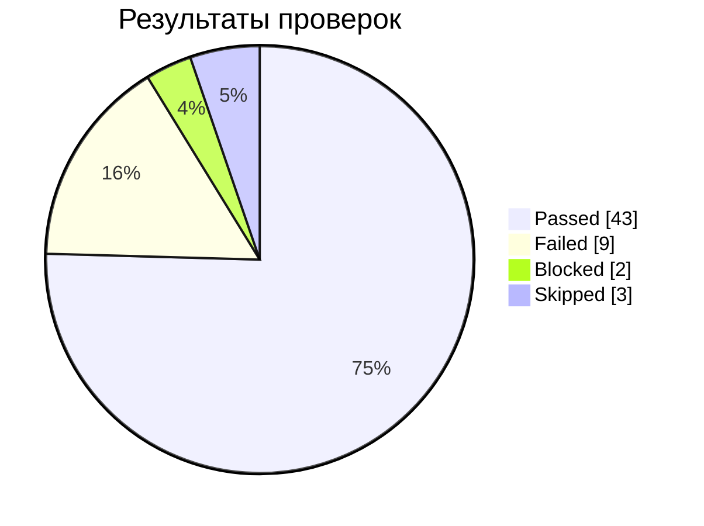
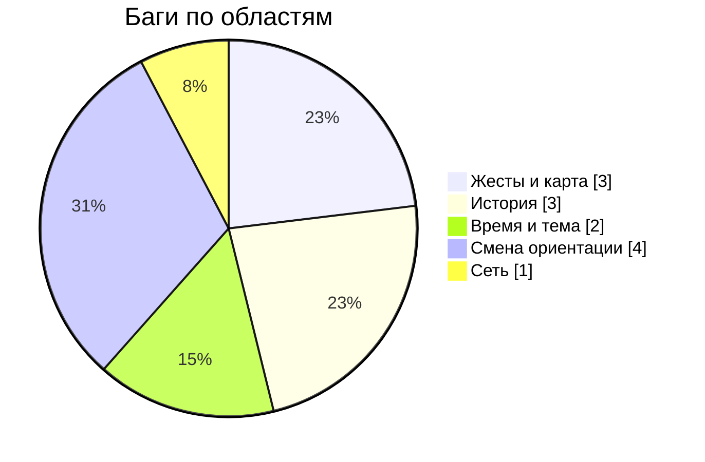

# Отчёт о тестировании и решение о релизе

**Объект:** «Метро» для Android v3.6 (после рефакторинга с v2.13). **Решение: 🟡 Conditional Go.**

## Метрики
| Метрика | Значение |
|---|---|
| Проверок | 57 |
| Passed | 43 (75.4% от всех) |
| Failed | 9 |
| Blocked / Skipped | 2 / 3 |
| Pass rate среди выполненных | 82.7% |
| Баги | 13 (critical 3, major 10, blocker 0) |

## Оценка рисков и решение
Блокирующих багов нет, но критические Б3, Б6, Б7 нельзя просто «принять». Решение принято по каждому багу:

| Баг | Серьёзность | Влияние | Есть обход | Решение |
|---|---|---|---|---|
| Б3 | critical | Неверное время поездки | нет | **Исправить до релиза** |
| Б6 | critical | Нет сообщения об ошибке сети | частично (индикатор сети в системе) | Исправить в ближайшем релизе |
| Б7 | critical | Не работает масштабирование схемы | да (поиск станций) | Исправить в ближайшем релизе; перепроверить на устройстве |
| Б1 | major | Жесты и карта | да | Бэклог |
| Б2 | major | История | да | Бэклог |
| Б4 | major | Смена ориентации | да | Бэклог |
| Б5 | major | Смена ориентации | да | Бэклог |
| Б8 | major | Время и тема | да | Бэклог |
| Б9 | major | История | да | Бэклог |
| Б10 | major | История | да | Бэклог (проверить, баг ли это) |
| Б11 | major | Смена ориентации | да | Бэклог (вероятный дубль Б4) |
| Б12 | major | Жесты и карта | да | Бэклог |
| Б13 | major | Смена ориентации | да | Бэклог |

**Условие релиза:** исправить Б3. Остальное можно выпускать с известными ограничениями, сведения о которых нужно передать в поддержку.

## Что остаётся под вопросом
- **Блокировки и пропуски:** 5 проверок не выполнены: Р3–Р5 пропущены и Р33 заблокирована из-за Б6, Ф13 заблокирована из-за Б2. Их нужно выполнить после исправления.
- **Одно устройство:** проверка на Android 9, 1080×1920. Жесты на эмуляторе могут отличаться от реального устройства (см. серую зону GZ9).
- **Возможные ложные срабатывания и дубли:** Б10 (станции с расстоянием — похоже на «рядом», GZ2) и Б11 (дубль Б4).
- **Противоречия в проверках:** Ф16 пройдена, но Б13 про то же поведение; нужно пересмотреть формулировки.

> Цифры пересчитаны из таблиц результатов. Исходный отчёт содержал расхождения (67 тестов против 57 строк в чек-листах), поэтому в документации использованы пересчитанные значения.

Интерактивный симулятор решения: https://ikqavscode-afk.github.io/qa-test-documentation/metro/release.html
